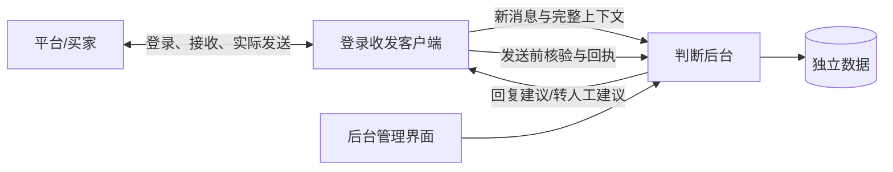

# Claw-Next

独立的客服系统：**前台负责登录和收发，后台负责判断，并提供管理界面。**

仓库：<https://github.com/lijiefeng11-wq/claw-next>。前后台都支持 macOS 与 Windows，首选同机部署在 Mac。

## 当前交付

### 后台（`backend/`）

- 后台 HTTP API、独立 SQLite 数据库、异步判断、规则引擎和可配置模型接口。
- 中文管理界面：店铺启用状态、规则/提示词、任务、判断、发送回执。
- 左侧五个页面：工作台、话术配置、处理记录、模型配置、系统设置。工作台每 5 秒同步店铺连接状态；它表示前台连接后台，不等于平台登录已验证。
- 管理页分别配置主模型和备用模型的地址、名称、密钥与超时；支持本地 OpenAI 兼容服务和 HTTPS 云端服务。主模型请求失败时自动尝试备用模型，合法的转人工决定不触发切换。密钥只写入后台私有数据，接口不回传。保存后可分别测试连接，测试使用虚构内容。
- 每店客户端身份、发送归属、重复事件保护、判断有效期、上下文失效、单次发送许可。
- 不确定发送结果保留为 unknown；不重发、不覆盖。重启中断的判断交人工，不盲目重做模型请求。
- 判断模式：规则、模型、混合（规则描述交给模型按语义匹配）；模型可从候选中选择附加发送（视频、商品卡片、说明书）。
- 判断调度：规则判断不排在慢模型后面；模型调用有界并发、按店铺公平排队。
- macOS 用钥匙串、Windows 用 DPAPI 保存模型密钥；macOS 可用受限 launchd 保活，见 [backend/MACOS.md](backend/MACOS.md)。

### 前台（`apps/client/`）

Electron + TypeScript 桌面客户端，详见 [前台 README](apps/client/README.md)。

- 一个主窗口内嵌各店铺的拼多多商家客服页，每店独立登录分区，切店不影响其他店铺继续收发。
- 被动读取页面自身请求的响应获取消息、历史和订单；页面变化即时触发扫描。
- 发送只点页面自己的按钮（经调试通道，不依赖窗口焦点），点击前核验店铺、买家与对话，以平台返回的消息编号确认；文字回复与附加发送（视频、商品卡片、说明书）。
- 首次看到消息起 20 秒内未开始发送则放弃该条、交人工。
- 前台不调用模型、不自行决定回复；后台失联时不降级为本地回复。

### 现状

自动测试与虚构页面验收不等于真实业务验收；正式使用前须逐店验收。多店同时运行、模型模式耗时和正式接管尚未验收。新数据目录默认使用规则模式且店铺关闭。

## 启动后台

Python 3.11+，无第三方 Python 依赖。在仓库根目录执行：

```console
python -m backend init
python -m backend serve
```

打开 <http://127.0.0.1:18880>，首次使用账号 **admin**、密码 **admin** 登录。仍是初始密码时，页面会直接弹出“修改密码”，必须先改密才能进入管理界面；关闭弹窗即退出登录，后台也会拒绝其他管理操作（`403 admin_password_change_required`）。请在本机回环地址完成这一步，再考虑受控的远程访问。新密码为 8–128 个字符且不能与当前密码相同；成功后所有管理员会话失效，使用新密码重新登录。已改过密码的旧安装不会再被要求改密。

管理员密码加盐哈希保存在数据目录的 `admin.sqlite3` 中，仅首次初始化时建立默认值；刷新、退出、重启或升级不会重置已修改的密码。备份和迁移时保留整个数据目录。管理员会话最长 8 小时，页面刷新或后台重启后需重新登录。

改密之后，“修改密码”默认收起，点击右上角“管理员：admin”打开；也可从“系统设置”进入。

旧版 `var/config.json` 可以继续使用，其中的 `admin_token` 已停用，不能登录或调用管理接口；新版 `init` 不再生成它。每店客户端仍使用配置里的独立 client token，**admin/admin 不能作为客户端口令**。配置和数据库均被 Git 忽略，禁止分享或上传。

`init` 只创建虚构店铺配置，遇到已有文件会拒绝覆盖。数据默认在 `var/data/`，同一数据目录只能启动一个后台进程。不要把这些路径指向其他系统的数据目录。

若本机没有 `python` 命令，改用已安装解释器的完整路径运行同样的参数（Windows 可在 PowerShell 用 `& '<python.exe 路径>' -m backend serve`）。

停止时在启动终端按 Ctrl+C。macOS 开机保活见 [backend/MACOS.md](backend/MACOS.md)；本项目不接管旧工作台。

## 启动前台

需要 Node.js 22.12+。另开终端：

```console
cd apps/client
npm ci
npm start
```

添加店铺、口令和模拟平台的用法见 [前台 README](apps/client/README.md)。

## 前后台接口

共同接口是 [协议 1.0](contracts/protocol.md)，所有请求格式、时间窗、错误和回执语义都以它为准。分工与协作规则见 [AGENTS.md](AGENTS.md)。



## 验证

```console
python -m unittest discover -s tests -v
node --check backend/static/app.js
cd apps/client && npm ci && npm run typecheck && npm test
```

全部使用虚构数据，不连接真实店铺，不发送买家消息。PR 会在 macOS、Windows、Ubuntu 上自动运行前后台检查。真实店铺接入与切换另行验收。

## 云端协作

见 [GitHub 协作与运行部署](docs/COLLABORATION.md)。GitHub 保存源代码、接口、测试和 PR；前后台运行时通过受认证的 HTTPS API 通信。GitHub 不存储聊天和订单，也不是运行消息队列。

本项目无备注/库存写入功能。任何正式店铺接入都需安排单店切换，先确认该店铺没有其他自动发送者，再开启本系统。

## 许可证与声明

本项目以 [MIT 许可证](LICENSE) 发布：可以自由使用、修改、分发和商用，须保留版权与许可声明。

- 本项目与拼多多及其关联公司无关，不是官方工具。
- 使用者须自行遵守所用平台的规则和适用法律，并对自己店铺的接入与发送负责。
- 按“原样”提供，不提供任何担保，作者不对使用后果承担责任（见 LICENSE）。
