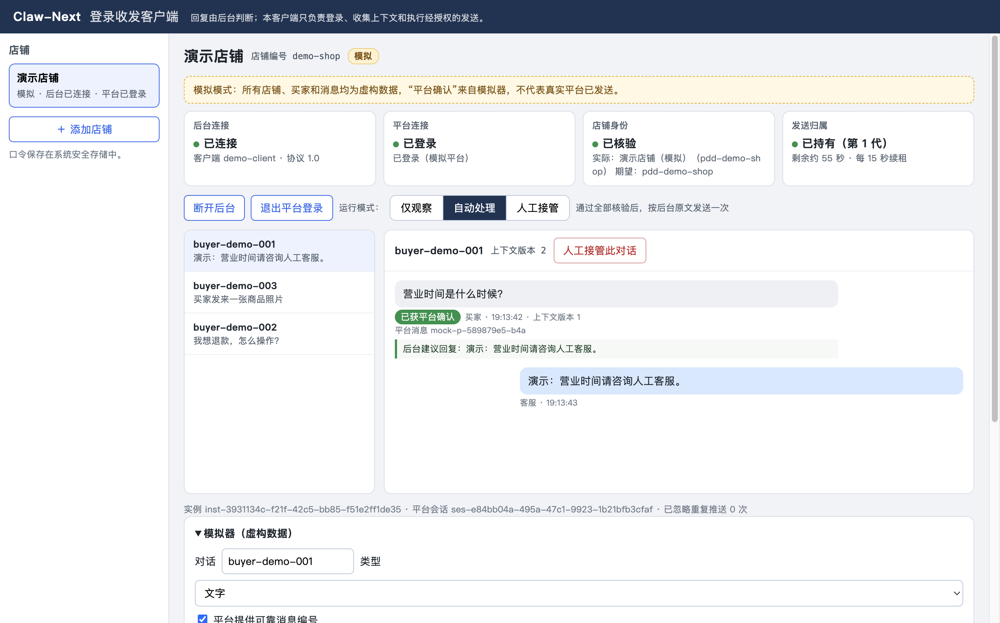

# Claw-Next 登录收发客户端（前台）

Electron + TypeScript 桌面客户端，按 [协议 1.0](../../contracts/protocol.md) 与后台对接。客户端只负责登录、按店铺隔离会话、收消息、收集完整上下文、本地持久化和执行后台批准的发送；**不调用模型、不自行决定回复，后台失联时不降级为本地回复**。



## 当前能力与边界

| 项目 | 状态 |
|---|---|
| 模拟平台适配器（虚构店铺/消息，界面标注“模拟”） | 已实现，自动测试覆盖 |
| 与真实仓库后台联调（health/me/heartbeat/events/claim/receipt） | 已实现，自动测试用真实 Python 后台验证 |
| 拼多多适配器：接收 | 每店独立分区的平台窗口；通过调试协议被动读取页面自身请求的响应（不主动请求平台、不伪造风控参数、不解析二进制长连接）。店铺身份取 `/chats/userinfo/realtime` 与 `queryCustomServiceInfo` 的店铺编号，二者一致才算核验。对话来自页面加载的 `/plateau/chat/list`，`has_more=false` 才算历史完整；订单从页面自己加载的订单接口被动读取。新消息经长连接推送、无法被动读取，当前每 1.5 秒扫描页面会话列表发现未读后点开对话再读取；只有本次会话开始后、120 秒内首次出现的买家消息算新消息 |
| 拼多多适配器：发送 | 已实现文字回复与附加发送（视频、商品卡片、说明书）。只点击页面自己的按钮，点击前核验店铺、买家与当前对话；以页面自己的发送请求与平台返回的消息编号确认，否则按 `not_sent`/`unknown` 规则处理。是否自动发送由店铺模式与后台判断决定 |
| 独立应用 | `npm run package:mac` / `package:mac-intel` / `package:win` 生成未签名的 macOS .app 或 Windows 文件夹版，见“打包成独立应用” |

自动测试与模拟成功不代表真实平台可用；正式使用前须逐店验收。正式店铺接管须用户另行安排，同一店铺只能有一个发送者，不能与其他自动回复工具同时自动发送。

## 运行

需要 Node.js 22.12+（见 `.nvmrc`）。后台需要 Python 3.11+。

```console
# 终端 1：仓库根目录启动后台（只含虚构店铺）
python -m backend init
python -m backend serve

# 终端 2：客户端
cd apps/client
npm ci
npm start
```

在客户端“添加店铺”：店铺编号填 `demo-shop`，后台地址 `http://127.0.0.1:18880`，平台适配选“模拟平台”，平台店铺编号任填（例如 `pdd-demo-shop`），客户端口令从本机 `var/config.json` 的 `clients[0].token` 复制。保存后点“连接后台”→“模拟平台登录”，用模拟器发送虚构买家消息。后台默认关闭回复，需在后台管理页（管理员账号与客户端口令相互独立）启用店铺并配置规则。客户端只使用本店客户端口令，不使用管理员账号或会话。

本机联调可用 `npm run dev`：从仓库 `var/config.json` 按店铺编号导入口令（存入系统安全存储、不打印），自动连接后台，并为拼多多店铺打开平台窗口（客服聊天页）。只处理后台地址为回环地址的店铺；终端打印平台登录、身份是否一致和收到消息的角色/类型，不打印消息内容。

应用数据目录为系统应用数据下的 `Claw-Next-Client/`（可用环境变量 `CLAW_NEXT_USER_DATA` 覆盖）：

- `config/shops.json`：店铺配置，不含口令；
- `secrets/<shop_id>.bin`：用系统安全存储（macOS 钥匙串 / Windows DPAPI）加密的客户端口令；
- `data/shops/<shop_id>/journal.jsonl`：每店收发日志（每条记录 fsync）；
- `config/session.json`：上次打开着的店铺（是否连着后台、拼多多平台页是否开着），不含口令。

启动时恢复上次打开着的店铺：按 `session.json` 同一店先连接后台（运行时此时就开始接收平台消息）、再打开拼多多平台页，不同店铺并行恢复；记录只在手动“连接后台/断开”“打开/关闭平台页”时更新，退出程序不改，因此开机自启或崩溃重启后会回到退出前的样子。运行模式（观察/人工/自动）沿用店铺配置，恢复时不改；口令缺失的店铺只打开平台页并记日志；单店失败不影响其他店铺；恢复期间对某店手动操作会作废该店剩余的恢复步骤。记录按“每店每项操作代次”写入：较早开始、较晚完成的操作不会覆盖较新的手动操作，打开平台页与连接后台互不作废。平台登录状态保存在各店独立的会话分区里，未过期时打开平台页即为已登录，过期则需重新扫码。`npm run dev` 与冒烟测试不做恢复。

## 界面端到端测试（Playwright）

`npm run e2e` 会先构建，然后用 Playwright（`playwright-core` 的 Electron 驱动）启动开发版客户端，并连上一个临时的虚构后台（仓库后台 + 虚构配置），像用户一样点击界面完成检查。全程只用模拟平台，不连接任何真实店铺，也不打开拼多多页面。覆盖：

- 渲染页面隔离：没有 `require`/`process`，只暴露 `invoke`/`onState`；
- 通过表单添加模拟店铺，连接后台，模拟平台登录（身份已核验、持有发送归属）；
- 新店默认“仅观察”：只显示建议回复，不发送；切到“自动处理”后，新消息经平台确认发送；
- 规则没命中时显示“建议交人工”（平台未执行转接）；
- 发送结果不确定时显示待核查，并提示不会重发；
- 人工接管对话后只给建议、不发送；
- 登录成其他店铺时提示疑似串店并停止，重新登录本店后恢复；
- “客户端设置”在开发运行时不可勾选；
- 店铺栏可收起成窄条并恢复；
- 拼多多店铺（只保存配置，不点“打开本店工作台 / 登录”，不创建平台页面）的平台工作台是紧凑操作栏，平台区域占窗口高度七成以上；缩放 − / + 与恢复自动；
- 弹窗清理脚本在虚构 `data:` 页面上：自动只关引导 / 活动浮层，人工清理再关普通对话框；违规提醒（包括按钮放在内层定位容器的）、含文本输入框的对话框、聊天区、包含聊天区的浮层都不碰；状态不泄露到页面脚本；页面缩放 80% 时原生点击仍命中目标；
- 弹窗清理与发送互斥（`scripts/test-popup-sweep.cjs`，独立 Electron 进程、真实渲染进程）：页面忙、清理脚本排队迟到时，发送准备等到脚本真正结束才开始，迟到的脚本过了点击时限不点击；清理期间渲染进程退出时过了点击时限才解除；
- 页面里不含口令。

说明：
- 口令通过 `CLAW_NEXT_E2E=1` 和 `CLAW_NEXT_DEMO_TOKEN` 只放内存，不落盘。这个入口只在未打包的开发运行时有效，打包版会忽略它。
- 截图写到 `CLAW_NEXT_E2E_OUT` 指定的目录；不设置时写到新建的临时目录（运行结束时打印路径），都会保留，不论成功还是失败。临时后台配置、后台数据和客户端数据每次结束都会删除。
- Linux 需要图形环境，可以用 `xvfb-run -a npm run e2e`；不能用 root 运行（客户端启用了沙箱）。

## 打包成独立应用

```console
cd apps/client
npm ci
npm run package:mac         # Apple 芯片 Mac → out/Claw-Next-Client-darwin-arm64/Claw-Next-Client.app
npm run package:mac-intel   # Intel Mac      → out/Claw-Next-Client-darwin-x64/Claw-Next-Client.app
npm run package:win         # Windows x64    → out/Claw-Next-Client-win32-x64/Claw-Next-Client.exe
```

- 脚本先编译，再只把运行需要的文件（精简的 `package.json`、项目 `LICENSE` 与 `dist/src`）打进 `app.asar`；不含测试代码、配置、口令、登录资料或店铺数据。打包时会下载对应系统的 Electron（与开发用版本一致），可在任一系统上打另一系统的包。
- **签名**：在 macOS 上打 macOS 包时，脚本自动做本机临时签名（ad-hoc，`codesign --sign -`）并校验；加 `--zip` 时（如 `npm run package:mac -- --zip`）再用 `ditto` 生成可分发的 zip，保留符号链接和权限。没有 Apple 开发者证书，也没有公证。
- **下载后首次打开**：ad-hoc 签名的应用下载后，第一次打开会被系统拦下，提示无法验证开发者。在“访达”里右键→打开，或者到“系统设置 → 隐私与安全性”点“仍要打开”。
- **在其他系统上打 macOS 包**：脚本无法签名，会给出提示。这样的包在 Apple 芯片 Mac 上下载后会报“已损坏”，要在 Mac 上先运行：
  ```console
  xattr -cr /Applications/Claw-Next-Client.app
  codesign --force --deep --sign - /Applications/Claw-Next-Client.app
  ```
- **许可证**：项目 MIT 许可证在 `app.asar` 里。Electron/Chromium 自带的 `LICENSE`、`LICENSES.chromium.html` 原样保留：Windows 文件夹版在程序目录里；macOS 版在签名前复制到 `.app/Contents/Resources/ThirdPartyLicenses/`，生成 zip 后逐条核对条目与原文。
- **Windows**：未签名，可能出现 SmartScreen 提示，选“更多信息 → 仍要运行”。
- **CI 打包产物**：每次 CI 都会在 macOS 和 Windows 上打包并运行冒烟测试，打好的包作为 artifact 上传，保留 7 天。macOS 是已签名的 zip，Windows 是文件夹。
- 打包版与 `npm start` 使用同一个应用数据目录（见上），已有店铺配置、口令与收发日志照常可用；两者不要同时运行（单实例锁会让后开的那个直接退出）。
- 验证打包产物：设置 `CLAW_NEXT_SMOKE_APP=<可执行文件路径>` 后运行 `node scripts/smoke.mjs`，用同一套冒烟检查打包后的程序（macOS 填 `.app/Contents/MacOS/Claw-Next-Client`）。

## 开机自启与崩溃后自动重启（打包版）

左侧栏底部“客户端设置”有两个勾选项，只在打包后的 Mac / Windows 应用中可用（`npm start` 开发运行时为灰色）。设置保存在 `config/startup.json`。

| 系统 | 开机自启 | 崩溃后自动重启 |
| --- | --- | --- |
| macOS | 用户级 LaunchAgent，任务文件放在 `~/Library/LaunchAgents/com.claw-next.client.plist`，登录时由系统加载 | 同一任务的 `KeepAlive.SuccessfulExit=false`：异常退出才重启，间隔至少 30 秒 |
| Windows | 系统登录启动项 | 随应用附带的守护程序（Electron Node 模式运行 `supervisor.js`，无窗口）：客户端非零退出时约 30 秒后拉起 |

- 正常退出（菜单退出、关闭窗口）不会被重启。只勾“崩溃后自动重启”不会开机启动：launchd 手册说明 `SuccessfulExit` 隐含 `RunAtLoad`，所以这种情况下任务文件放在客户端数据目录的 `launchd/` 下（不在 LaunchAgents 里），只在交接时由客户端加载。
- 开启崩溃重启后，手动打开的客户端会交给系统托管（macOS）或守护程序（Windows）重新启动自己，这样之后的崩溃才能被拉起。两边都**先等旧进程退出、让出单实例锁**再启动新实例；Mac 还会确认任务确实在运行，约 15 秒内没起来就用 `--no-handover` 直接重新打开应用，不会就此消失。
- 守护程序每次拉起前（退出后、等待后）都重新读取设置；用户关闭“崩溃后自动重启”后不再拉起。
- 重启预算：5 分钟内最多自动启动 3 次（开机启动也计入；`config/restarts.json`）。超过就弹窗提示并停住，防止反复崩溃；手动打开会清空预算。守护程序另有硬上限，防止客户端在检查预算前就崩溃造成循环。
- 自定义数据目录（`--user-data` 或 `CLAW_NEXT_USER_DATA`）会以 `--user-data` 参数写进开机启动项、LaunchAgent 与守护程序启动的客户端，登录时没有原来的环境变量也能用同一个目录。启动参数优先于环境变量。
- macOS 系统里已加载的任务何时更新：不是托管启动时，保存设置会先卸载旧任务、重写任务文件（开启崩溃重启需重启客户端完成加载；只勾开机自启则下次登录加载）；由系统托管运行时改设置只改文件，系统里的任务在本次正常退出后、下次手动打开（启动时先卸载旧任务）或下次登录时更新。关闭两个选项会删除任务文件 / 登录启动项。
- 重新打开后按“启动时恢复上次打开着的店铺”恢复，运行模式不变；发送规则（claim、回执、unknown 不重发）不变。
- 守护程序日志：`logs/supervisor.log`（只有启动、退出码和下一步动作）。

## 验证

```console
cd apps/client
npm ci
npm run typecheck
npm test        # 单元测试 + 与真实后台的联调测试（自动启动临时后台，虚构数据）
npm run smoke   # 启动 Electron：检查渲染页无 Node 权限、IPC 校验、口令不泄露，跑一遍模拟收发并截图
```

`npm run smoke` 需要图形环境，它会在临时后台启用演示店铺的规则回复，并把前台模拟店铺设为自动处理（只发往模拟平台，不接触真实平台）；只想检查接收时不要用它。可用 `CLAW_NEXT_SCREENSHOT=<路径>` 指定截图位置。

## 处理顺序（摘要）

1. 启动时 `GET /health`、`GET /api/v1/me`，核对协议主版本 1、角色 client、`shop_id` 与本店配置一致（口令属于其他店铺时拒绝）。
2. 每次连接生成新 `instance_id`（同一进程内断开后重连沿用）；每次平台登录生成新 `session_id`；约 15 秒续租，本地以发起时刻 +60 秒与服务端 `expires_at` 取小值判断租约。
3. 平台消息同步写入本地日志并递增 `context_revision` 后才继续处理。稳定消息 ID 去重；没有可靠 ID 的消息只保存，转人工；历史同步/重连回补只记录，不提交。
4. 取平台完整历史，超过 200 条或 256 KiB 时停止自动处理，不截断。历史缺口如实上报 `history_complete=false`。
5. 先在本地持久化 `event_id` 和原始请求体，再 `POST /api/v1/events`；超时用同一请求体原样重投。
6. 轮询判断（0.5 秒起步，失败退避）。只有“自动处理”模式、ready+reply，且通过全部本地核验，才申请发送许可。
7. 先落盘 `attempt_id` 再 `claim`；拿到许可后再次核验，然后落盘“即将发送”，再调用一次平台发送。
8. 回执：平台明确确认并给出平台消息 ID 时报 `sent`；确定未调用平台时报 `not_sent`；其余（超时、崩溃、只有传输确认）报 `unknown`。回执上传失败只补传回执。

重启恢复：处于“即将发送”的尝试一律记为 `unknown`；申请许可后但未开始发送的报 `not_sent`；未确认提交的事件原样补报，但旧会话的任务不会发送。`unknown` 只锁定该条事件：永不重发、不再申请许可，界面标“结果待核查”提示人工核查；同一买家之后的新消息作为新事件照常判断与发送（契约“unknown 人工核查”一节）。客户端没有清除 `unknown` 的功能。

`unknown` 自动核对（只提示人工）：发送开始后第 8 秒、第 30 秒读该买家的聊天记录，只比对发送前本地没见过、且发送后出现的客服消息（文字按全文忽略空白，附加内容按候选名称/商品标题）。只认发送调用返回之后刷新的聊天记录（打开对话时的加载不算）：出现则标“待核查·记录里已看到”；“待核查·记录里没看到”（提示人工补发）只在最后一次核对、且有单次加载的覆盖证据时才给出：该页在发送返回后加载、没有丢弃消息、含触发本次回复的买家消息、且最新消息晚于发送开始 30 秒以上（平台一页是连续的，因此覆盖了发送前后）；加载时间、累计的完整标记或最新段都不算证据。证据不足、记录未刷新、或有解析不了的客服消息（视频、说明书目前只记为非文字消息）时标“结果待核查”，只提示到平台核查，不引导补发。结论只存本地、不上报后台、不改变 `unknown`、不触发重发；重启后不再补做核对。日志 `unknown_stats` 按类型与原因累计本次运行的 `unknown` 次数，不含回复正文。

## 安全

- 主进程持有口令、日志和发送能力；渲染页面 `contextIsolation`、`sandbox`、无 `nodeIntegration`，只通过预加载脚本暴露 `invoke`/`onState`。
- 主进程校验 IPC 来源（必须是本地界面页面）、通道白名单、参数类型与字段、店铺是否存在。
- 页面 CSP 禁止外部脚本和网络请求；本地界面窗口禁止导航和新窗口；平台登录窗口只允许拼多多 HTTPS 域名，无预加载脚本。
- 每店平台会话使用独立持久化分区 `persist:claw-next-shop-<shop_id>`。
- 口令只在 `Authorization` 头中发送，不进 URL、日志或页面；远程后台必须是 HTTPS，后台请求不跟随重定向。

### 本地回复时效

新消息第一次被识别时，客户端持久记录首次观察的墙钟毫秒；本次进程用单调时钟计算 20 秒发送开始预算，重复推送和历史转实时不重置。重启按原墙钟时间恢复剩余预算；这依赖本机墙钟可信，缺失、非有限数值或晚于当前时间的记录按已超时处理，不能借重启重新取得 20 秒。

默认判断查询间隔为 500 ms，失败仍退避。准备阶段（确认订单与收集可发送项）合计目标 2 秒，同时不超过 20 秒剩余预算：自动模式且附加发送已确认时，订单在收集候选时一并确认，不再先单独读一次；说明书对话框只在准备预算剩余不少于 1 秒时打开，读不完的候选省略、不当作“没有”。该买家的处理全部结束后再在后台预热（补齐过期的推荐商品与说明书，只做界面操作、不发送）；页面有焦点、输入框有字或已有对话框时不预热，发送、准备与新消息扫描开始前会先让预热在下一步之间停下，不会因此以“忙”拒发。申请许可前、许可返回后和真正点击前检查同一时限：超时只标记“本条待人工”，不接管整个买家；已开始的发送仍按原许可和回执规则完成，unknown 永不重发。20 秒约束开始发送，并不要求 20 秒内收到确认。

`timing_summary` 每条正在处理的消息输出一次脱敏摘要：引用、总耗时、超过 10 秒标记、放弃原因、准备/提交/等待后台/许可/发送/回执分段及最慢段。缺失的历史时间记为 null，未执行的阶段不补零。平台到前台发现延迟无法从这些字段推算。重启不会为未恢复处理的历史消息补造摘要。

#### 契约 A：剩余预算、取消与后台计时

按 `contracts/protocol.md`“契约 A”实现前台部分；本地 20 秒限制仍是最后一道检查，后台截止不替代它。

- **能力协商**：心跳总是声明 `reply_deadline`。只有最近一次成功心跳为本租约（instance + session + generation）确认了该能力，才提交预算、调用取消；旧后台不确认时完全保持原行为，只做本地限制，不试探新字段。
- **预算冻结**：准备完成、首次写入待提交请求体前，用单调时钟算剩余毫秒，向下取整并限制在 0–20000，写进请求体后不再改；重投与重启补报都用原请求体。本地算出 0 时不提交，直接“本条待人工”。
- **截止终态**：后台返回 `ready + handoff` 且原因是 `reply_deadline_exceeded`，或 claim 返回 409 `reply_deadline_exceeded`，都显示“本条待人工”，不重试、不给买家加接管锁，同一买家新消息照常处理。
- **能力撤回**：已冻结预算的请求体在首次受理前遇到能力撤回，后台返回 400 `capability_not_confirmed`；前台记为被拒、显示“本条待人工”，不换事件编号、不删预算重投。
- **取消**：仅在自动模式下，本地到期且能力已确认、仍持有原租约、本地与后台都没有发送尝试时，先落盘取消意图，再用原事件的四字段调用取消；网络失败只原样有限重试。观察/人工模式不取消（后台预算照常到期）。重启后只有意图、没有结论的事件只查询快照记录结论，不以旧意图发起取消；新实例也不首次取消旧实例的事件。已领取或 unknown 的事件永不取消、不重放。
- **后台计时**：快照里的 `timing` 只写进 `backend_timing` 日志（与前台 `timing_summary` 分列），不参与发送授权；已知字段任一不合法就整个忽略，未知字段忽略，快照其余字段照常严格校验。

测试：`test/replyDeadlineContract.test.ts` 有三组。
- 新前台/旧后台：用 `withoutCapability("reply_deadline")` 从心跳响应里去掉该能力，不论 `CLAW_NEXT_BACKEND_ROOT` 指向哪个后台，都固定验证旧后台组合。`test/replyDeadline.test.ts`（本地 20 秒限制）同样固定为旧后台组合。
- 新前台/实际 Python 新后台：后台在心跳中确认 `reply_deadline` 时才运行，否则跳过。覆盖合法预算、本地到期后的真实取消、无 claim/receipt、同一买家后续消息照常。
- 新前台/虚构契约 A 后台（`test/fakeDeadlineBackend.ts`）：覆盖实际后台难以稳定复现的情形，如响应丢失后重投、claim 409、冻结后撤回能力、重启时只有取消意图、timing 不合法。

### 新消息发现的本机验收

会话列表和当前消息区域的变化在独立隔离环境中通知主进程，与 1.5 秒兜底共用串行扫描器。空闲时使用固定 50 ms 合并窗口；发送或准备期间只保留一次补扫，调试器断开后继续定时扫描。变化信号不包含消息正文，也不作为消息的首次发现时间。

运行 `npm run build` 后，用本机 Electron 执行 `scripts/test-message-watcher.cjs`（例如 `npx --no-install electron scripts/test-message-watcher.cjs`）。脚本使用临时用户目录和虚构 HTML，拒绝 HTTP/HTTPS 请求，覆盖空闲变化到扫描不超过 200 ms、发送期间补扫、慢扫描不重入、列表替换、页面重载和调试器断开恢复。该结果不代表真实平台发现或端到端回复耗时；没有接入真实店铺或发送消息。

### 多店平台工作台（macOS 集成）

平台登录页嵌在主窗口内，左侧切店保留各自的独立会话；“收发记录与设置”可返回本地记录。后台店铺页面持续挂载在不透明的本地界面后方，禁用后台节流；有平台页面时防止应用休眠，关闭最后一页即释放，不阻止显示器休眠。改变界面透明度或视图层级时须重新验证覆盖关系。

页面点击使用 CDP 的视口 CSS 坐标，不依赖桌面焦点、不乘页面缩放（Chromium 按页面缩放换算；界面端到端测试在 80% 缩放下核对点击仍命中目标）。按下前核对页面代次、尺寸及发送许可；按下命令开始后的拒绝或超时均保持 unknown，不重试。CDP 命令返回成功仍须等待原有平台回执，不能当作发送成功。

完成构建后运行 `npx --no-install electron scripts/test-platform-workspace.cjs /绝对路径/验收目录`。该脚本使用临时用户目录、两个虚构平台页面和本地 HTTPS 协议替身，不访问真实平台、不连接后台；检查切店、页面覆盖、缩放、并行点击、最小化、IPC 和关闭清理。输出 JSON 与本地界面截图（截图不包含原生平台子视图）。这属于 Mac 合成页面验收，真实店铺登录及业务收发仍须另行验收。

### 平台工作台布局、页面缩放与弹窗清理

- 平台工作台只占一两行操作栏：店名、四个状态小标签（悬停看详情）、运行模式、页签、缩放和操作按钮；常驻说明与大状态卡片留在“收发记录与设置”。需要处理的提醒（页面异常、后台不可用、疑似串店、发送归属被占、结果待核查）仍显示在平台区域上方。
- 店铺栏可收起成窄条（店名前两个字与状态点），偏好只存在本机界面存储。主窗口默认铺满主屏工作区（不超过 1680×1050）。
- 页面缩放：默认“自动”，按平台区域宽度在 67% / 75% / 80% / 90% / 100% 中选最大的、使页面按约 1400 像素宽排版的档位；− / + 手动调整，点比例恢复自动。主进程只接受这几个档位，只作用于正在显示的店铺页面，导航后重新应用。比例变化与尺寸变化一样使页面代次失效：未执行的坐标点击按“页面已变化”放弃，不会点错位置。
- 弹窗清理（`src/main/pddPopups.ts`，在隔离环境执行）：
  - 自动：每 2 秒检查一次，只在已登录的聊天页、没有发送 / 准备 / 预热时进行；只点浮层里“我知道了 / 跳过 / 下次再说”等无副作用按钮，以及类名是引导、公告、活动类浮层的关闭图标。不点“关闭 / 取消”，避免关掉人工自己打开的对话框。
  - 人工“清理弹窗”按钮：连清最多 5 轮，另外点浮层里的“关闭 / 取消”和任意浮层的关闭图标。
  - 浮层取按钮祖先链上最外层的定位容器（fixed，或 absolute 且 z-index ≥ 100），检查针对整个容器：不碰聊天输入区、消息列表、买家列表、说明书与视频弹窗、含文本输入框或包含这些区域的浮层；浮层文字涉及协议、授权、付款、违规处罚等内容或超过 400 字时留给人工。按钮放在内层定位容器里也逃不过外层对话框的检查。
  - 点击时限：清理脚本须在提交后 1.5 秒内开始执行，每次点击前也核对；过了时限不点击（页面忙时排队迟到的旧脚本不改变页面）。
  - 互斥：发送、准备开始前先等进行中的清理真正结束，不按超时放行；页面导航、渲染进程退出、页面关闭或脚本执行失败时，过了点击时限才解除。清理 10 秒仍未结束就重新加载平台页面，由导航结束它。清理关掉浮层时页面代次加一。
  - 日志只记点过的按钮文字与浮层结构签名；跳过的浮层同一签名只记一次（附不含数字的短标题），用于补充规则。

### 平台页面掉线与崩溃提醒

客户端根据平台页面的生命周期事件（加载完成/失败、渲染进程退出、无响应）和登录跳转判断页面健康，不读取页面内容：

| 情况 | 处理 |
|---|---|
| 页面崩溃 | 结束本次平台会话（旧会话的任务失效），约 2 秒后重新附加调试通道并重新打开聊天页 |
| 页面无响应超过 30 秒 | 结束该页面的渲染进程，随后按崩溃恢复 |
| 页面加载失败（多为网络问题） | 每 15 秒重试一次，不计入恢复次数 |
| 10 分钟内自动恢复 3 次仍异常 | 停止自动重载，提示人工检查；页面上有“重新加载平台页”按钮 |
| 登录后跳回登录页 | 标记“平台登录已失效”，需要人工扫码 |

正在发送时先等发送结束（最多 30 秒）再恢复。恢复会使页面代次失效：尚未点击的操作按未发送放弃，已经点击的保持原有判定（平台未确认即 unknown），不会重发。

出现上述情况时，左侧店铺标红并显示原因，同时发一次系统通知（只含店铺名与原因，不含买家内容）；恢复正常后提醒消失，再次出现才会再通知。用户主动关闭平台页、模拟店铺或从未登录过的页面不提醒。
