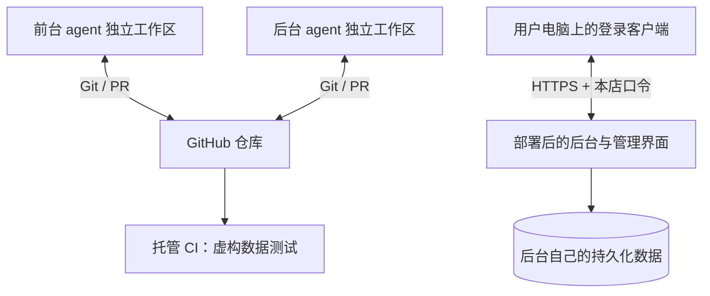

# GitHub 协作与前后台互通

## 选择：一个仓库，两个独立开发目录

仓库是 <https://github.com/lijiefeng11-wq/claw-next>，产品名 Claw-Next。当前阶段共同协议变化较频繁，把前后台放在同一个仓库可让一个 PR 同时展示接口、实现和测试；没有必要先拆成多个仓库再维护不同版本的依赖。

| 目录 | 负责人 | 内容 |
|---|---|---|
| `apps/client/` | 前台 agent | 登录客户端、平台适配、收发、本地持久化和前台测试 |
| `backend/` | 后台 agent | 判断服务、后台管理页面、数据和权限 |
| `contracts/` | 双方共同审查 | 协议和兼容性 |
| `tests/` | 后台 agent，前台可运行 | 共享协议黑盒测试和恢复测试 |
| `.github/`、共同文档 | 后台负责人统筹 | CI、PR 规范、发布说明 |

每位 agent 使用自己的 clone 或 worktree。**不能共用一个目录然后来回切分支**；相同磁盘上的两个会话也必须各有目录。云端 agent 与本地 agent 通过 Git 提交同步，不依靠彼此本地绝对路径或聊天记录。

前台可执行：

```console
git clone https://github.com/lijiefeng11-wq/claw-next.git Claw-Next-Frontend
cd Claw-Next-Frontend
git switch -c claude/具体任务
```

前台分支用 `claude/` 前缀，后台用 `codex/` 前缀（如 `codex/backend-具体任务`）。main 是共同基线。日常步骤：拉取 main → 独立分支实现 → 本地检查 → push → PR → CI 和负责人审查 → 合并 → 双方更新 main。前台先依协议写模拟器，不需要等真实店铺登录。

GitHub 官方流程依据：[GitHub flow](https://docs.github.com/en/get-started/using-github/github-flow)。本项目的分工和目录是本项目的约定。

## 接口变更流程

当前版本为 1.0，HTTP 路径 `/api/v1/`。字段、身份、错误、回执状态以 `contracts/protocol.md` 为准。

不兼容修改需先开接口讨论/PR，写旧行为、新行为、两端实施者、兼容措施及测试。先合并一致的契约和测试，再各自实施；不能前台悄悄改请求、后台悄悄换字段。交付时记录双方 commit 和协议版本。增量可选字段也要写入契约，旧客户端不能理解的主版本必须拒绝自动发送。

初始导入只建立一个可工作的基线；以后通过 PR 审查变更。建议 main 设置：禁止强推、合并前检查通过、至少一名非作者审查。分支保护需在仓库设置中实际开启；如果账户不支持，文档约定不等于服务器强制保护，不能声称已经锁定。CODEOWNERS 只指定审查归属，也不等于系统文件写保护。

参考：[受保护分支与套餐条件](https://docs.github.com/en/repositories/configuring-branches-and-merges-in-your-repository/managing-protected-branches/about-protected-branches)。本仓库不自动购买套餐、不扩大任何账号权限。

## 云端“协作”和运行“互通”是两件事



GitHub 不接收业务消息、不是队列、不能代替正在运行的后台。前台 agent 在云端也无法替用户保持 Windows 桌面店铺登录；云端可开发/构建/模拟测试，真正的登录客户端运行在用户安排的电脑用户会话中。

第一阶段先同机开发：客户端连 `http://127.0.0.1:18880`。第二阶段可将相同 Python 后台放到独立服务器：客户端只向外连接 HTTPS 后台，不需要开放客户端电脑的入站公网端口。后台不接收平台 Cookie，模型密钥仅在后台。

## 部署准备

当前服务是单进程、小规模联调设计；一个数据目录只允许一个后台进程，SQLite 负责持久化。云端首版也保持单实例；不能把此程序横向扩多副本，否则需要另行设计共享数据库、租约与队列。

部署机需要 Python 3.11+。先在独立目录生成私有配置，再配置经授权的 shop/client 映射。管理员首次使用 admin/admin 登录网页并自行修改密码；客户端只使用本店独立 token，不能使用管理员密码或登录会话。旧配置 `admin_token` 已停用。配置和数据在仓库外或已忽略的 `var/` 中，不通过 Git 分发。口令通过用户认可的安全方式传给客户端，不能贴到 issue/PR。正式密钥应由服务账号/秘密管理提供。

升级/备份保留整个数据目录，包括管理员密码哈希数据库 `admin.sqlite3` 和业务数据库；启动不会重置已有密码，重启会撤销管理员会话。浏览器关闭或刷新只清理本地会话；“退出登录”同时请求服务端撤销当前会话，“修改密码”撤销全部管理员会话。默认账号是应用账户，不授予操作系统管理员权限。

服务默认只监听回环地址。在独立服务器上可直接保持回环监听，由 HTTPS 反向代理转发；只有明确配置了私有容器网络和 HTTPS 代理时才使用 `--host 0.0.0.0 --allow-remote`。反向代理应限制访问来源、连接数、请求速率和请求体大小，并保证转发 Authorization。不要把 Python HTTP 端口直接暴露到公网。管理界面建议只对管理员网络或 VPN 开放。

后台模型配置在本地 config 的 `model` 字段：

```json
{"base_url":"https://api.deepseek.com","model":"填写账号实际可用的模型名","api_key_env":"CLAW_NEXT_MODEL_API_KEY"}
```

这是 Chat Completions 兼容接口，发送 JSON 模式请求，密钥从对应环境变量读取；不从其他系统拷贝密钥，管理页面不显示它。未配置、错误、非法返回均交人工，不自动重试付费请求。接口参考：[DeepSeek Chat Completions](https://api-docs.deepseek.com/api/create-chat-completion/)。模型支持情况和真实效果需部署时另外验证，首版没有用真实密钥测试。

如使用容器，仓库的 Dockerfile 提供同一后台的启动方式。构建/容器运行需要部署环境另行验证；本地 Python 测试不等于容器上线成功。

```console
docker build -t claw-next-backend .
```

挂载 `/run/secrets/claw-next.json` 为只读私有配置，`/app/var` 为持久化数据；容器用户 UID 10001 需要能读配置、写数据。只把 18880 绑定宿主回环或私有网络，HTTPS 入口由独立代理提供。不要挂载其他系统的目录。

## CI 与远程 agent 权限

GitHub Actions 运行虚构数据的接口/恢复测试、Python 编译检查和管理页面 JavaScript 语法检查。前台接入后，增加其真实存在的锁文件安装、类型检查和测试任务，不能放永远成功的占位任务。

不需要在 CI 中放模型密钥、平台口令或真实聊天。使用 GitHub 托管 runner，不把现有业务电脑作为 self-hosted runner。另一个云端 agent 使用它自己的 GitHub 连接获得本仓库权限；当前会话能访问，不代表其他工具/账号自动获得权限。

## 正式接管前的验收

本次新建不切换任何真实店铺。后续先选独立测试账号/店铺并明确安排，验证平台登录身份、接收、完整历史、唯一发送归属、平台确认和自然对话效果，再计划单店切换。切换时先停止该店铺原有的自动发送者，核实无未决发送，再启用本系统。出现 unknown 时人工核查，不能重放旧任务。

回滚是让新端停止新发送，保留全部 journal/unknown 证据，再按已确认的单店归属恢复原发送者。不能简单双开或把未知结果重新排队。正式云端地址、服务器、域名和登录账号还未选择；GitHub 仓库建立不等于完成云端部署。
